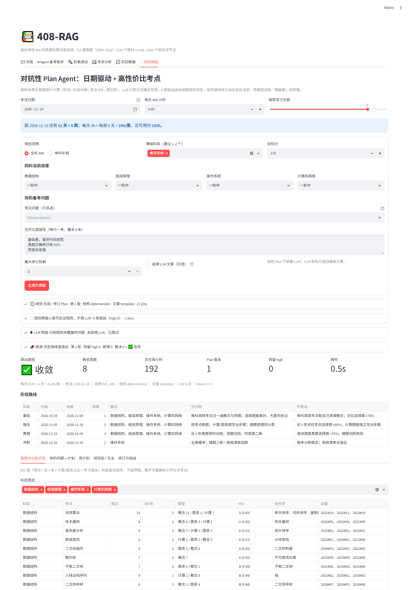

# 408-RAG

[](https://github.com/abedonl/408_Rag/actions/workflows/ci.yml)

面向考研 408 的真题检索问答与考点分析系统。

基于 **720 道历年真题（2009–2026）** 与 **6182 个知识点节点**，构建多路混合检索
（dense + BGE-M3 sparse + BM25，按题型自适应选路）+ 小节去重 + Agent 编排的问答链路，
并附带完整的消融实验与考点分析能力。交叉编码器重排经消融验证为负收益，未启用。

> **状态**：一期（检索 + 生成 + 服务 + 消融）与二期（Agent 编排 + 考点分析 + 图表解析）已完成。
> 二期分层评测结果见「Agent vs 单轮 RAG」一节。

---

## 60 秒了解

**一句话**：面向 408 考研的真题 RAG + Agent + 对抗性备考 Plan；重点不是「功能多」，
而是**每个结论都有可复现的数字，负结果也如实写**。

| 指标 | 结果 |
|---|---|
| 真题 / 教材 chunk / 知识点 | 720 题（2009–2026）/ 5296 chunk / 6182 节点 |
| 生产检索（dev 452 题） | Accuracy@10 **0.668**，Recall@10 0.382，P50 **35–49ms** |
| held-out（2023–2026，99 题） | Accuracy@10 **0.687**，P50 54ms |
| Agent 对抗 Plan 规则 | 黄金 Plan **0 误报**；6 类注入 **40/40 检出** |
| 测试 | **135 passed**（数据相关测试需本地题库） |

**架构**

```text
真题 / 教材 / 思维导图
        │  清洗、切块、父子结构、知识点图谱
        ▼
   Qdrant（dense+sparse+BM25）      Neo4j（6182 节点 + 148 前置边）
        │                                   │
        └──────────────┬────────────────────┘
                       ▼
用户问题 → 规则路由 → 检索 → zscore 融合 + 小节去重 → 父节上下文
                       │
        ┌──────────────┼──────────────────┐
        ▼              ▼                  ▼
     单轮 RAG      Agent（9 工具）     对抗性 Plan
                  计算器/图解析/考点    规则质疑 + LLM 文案
```

**60 秒跑起来**

```bash
cp .env.example .env          # 填 LLM key；不填也能跑检索、规则评测和离线 Plan
docker compose up -d          # Qdrant + Neo4j
uv sync
streamlit run app/streamlit_app.py
```

首次构建索引见「快速开始 → 首次构建数据」。不想配 LLM 时，打开「🛡 对抗规划」，
保持「启用 LLM 文案」关闭，点击「生成并质疑」即可看到完整 Plan（约 0.5s）。



**CI**：`.github/workflows/ci.yml` 跑 `ruff` + 不依赖数据/模型的纯函数单测；
完整评测需要本地 `data/processed` 与 Qdrant，按「快速开始」重建。
推到 GitHub 后 Actions 会自动跑；本地提交历史已初始化：

```bash
gh repo create 408-rag --public --source=. --remote=origin --push
```

---

## 这个项目解决什么问题

考研 408 备考的真实痛点不是「找不到资料」，而是：

1. **不知道什么值得背** —— 需要的是真题频次的客观统计，不是泛泛的「重点章节」
2. **不懂的知识点查不动** —— 教材厚重，检索质量差
3. **计算题和图表题看不懂** —— 单纯的文本检索对此类题目无解

一期的三路混合检索解决第 2 点；二期的 Agent 编排解决第 1、3 点：
计算题交给确定性计算器，图表题做 SVG 拓扑重建，备考咨询只归纳真实真题频次。
**每一层都有独立评测，包括 Agent 没有赢的那部分。**

## 教材插图

王道正文里有 **1282 张插图（22.1 MB）**，408 的很多概念离开图就讲不清（树的形态、Cache 结构、
TCP 状态机、流水线时空图）。检索结果必须能把图一起带出来。

**处理链**：

```
Markdown 里的  + 图注
   ↓  md_loader 抽取（含 anchor：图前 60 字正文，用于定位它属于哪一段）
   ↓  chunker 按 anchor/图注把图片挂到**对应的那个 chunk**（不是整节所有 chunk）
   ↓  chunk payload 存 {image_id, src, caption}
   ↓  image_index.json 落盘：image_id -> {path, subject, url, bytes}
   ↓  输出时按 image_id 查索引，返回 /v1/image/{id}
```

**实测**：1044 张图成功归属到 710 个 chunk；检索 `树的基本术语` 会带出
`图 5.1 树的树形表示`，`/v1/image/{id}` 返回真实 JPEG。

### 真题解析里的图

除了教材插图，**47 道真题的官方解析里也带内联 SVG**（过程图、资源分配表、
状态转换图）。其中 7 道属于 held-out 年份，按防泄漏口径不生成索引，
实际入库 **40 题 / 45 张 SVG**（4.3 MB），落盘 `data/processed/exam_figures/`，
合并进同一份 `image_index.json`（总计 **1327 张 / 26.5 MB**）。

解析 chunk 的 payload 现在包含：

```json
{
  "text": "题干 + 选项 + 解析全文",
  "meta": {"qid": "2009-02", "answer": "C", "tags": ["入栈出栈序列"]},
  "images": [{"image_id": "exam-2009-06-1", "caption": "2009-06 解析配图 1"}]
}
```

检索命中解析时，`/v1/retrieve` 会返回可直接渲染的 `/v1/image/{id}`。
实测 `2009-06` 返回 3 张 SVG，`exists=true`。

**几个设计决定**：

- **image_id 带科目前缀**（如 `数据结构-dac856...`）。部分科目图片名是 `2-1-image-007`
  这类短名，不加前缀跨科目会撞。
- **图片挂到具体 chunk 而不是整节**。一节常切成 3–5 段，都挂同一批图会让检索结果塞满无关插图。
- **图片不进 prompt**。LLM 看不到图，硬塞图注会让它臆测图像内容；只把图注作为提示，
  图片本身给前端渲染。
- **索引缺失不报错**。`resolve_images` 找不到时返回空 url 而非抛异常 —— 缺图不该阻断检索。

| 接口 | 说明 |
|---|---|
| `GET /v1/image/{image_id}` | 返回图片文件 |
| `GET /v1/images/stats` | 索引概览（1282 张 / 22.1 MB） |
| 检索/问答响应 | 每条结果带 `images: [{image_id, caption, url, exists}]` |

## 已知问题与优化待办

### ⚠️ 思考模式与空正文（已解决参数写法）

实测 `sensenova-6.8-flash-lite` 默认开启思考，且 reasoning token 可能远超正文：
不控制时通常 500–1000，图表题长 prompt 可超过 3200，把 `max_tokens` 吃光后
**`content` 返回空**（`ok=True`、`completion_tokens == max_tokens`），
比报错更难发现。

正确参数（在 `sensenova-6.8-flash-lite` 上实测）：

| 写法 | 结果 |
|---|---|
| `thinking: {"type": "disabled"}` | ✅ 接受；长 prompt 下 reasoning 从 1000+ 降到 ~55，多数题正文正常 |
| `thinking: "disabled"`（字符串） | ❌ 返回 400 invalid arguments |
| `output_config: {"effort": "none"}` | ⚠️ 接受，但降思考效果不稳定；与 `thinking` 同传反而更高 |
| `reasoning_effort: "none"` | ⚠️ 短题有效，长题仍 1000+ |
| `enable_thinking: False` | ❌ 被忽略 |

`llm.py` 传 `thinking: {"type": "disabled"}`（`LLM_ENABLE_THINKING=1` 时传
`enabled` + `output_config.effort=high`）。遇到不认该参数的供应商会 400，
客户端自动去掉参数重试。**换 endpoint 后先验证参数是否生效**，否则会重现空正文。

**仍存在的边界**：少数题会让模型陷入长思考，即使 `thinking=disabled`
也会把 3200 token 全用于 reasoning、返回空正文（如 2017-13）。
这类题在评测里如实计为错误，不粉饰。根治办法是换多模态模型或配 VLM。

**备用模型降级**：主模型在「预算翻倍后仍空正文」时，自动切到
`LLM_BACKUP_MODEL`（当前 `glm-5.2`）重试一次。同一批 20 道 held-out 题 A/B：

| 模型 | 准确率 | 空回答 | 可判题准确率 | 平均延迟 |
|---|---|---|---|---|
| `sensenova-6.8-flash-lite`（主） | **80%** | 2 | **88.9%** | 15.8s |
| `deepseek-v4-flash` | 75% | 2 | 83.3% | **23.9s** |
| `glm-5.2`（备用） | 75% | **0** | 75.0% | 14.9s |
| `deepseek-flash` | 70% | 1 | 73.7% | 15.9s |

`deepseek-v4-flash` 虽然能关闭思考，但 RPM 很低（多次 429 退避），
空回答并没有比 sensenova 少，延迟反而最高，因此不采用。
主模型准确率最高，备用模型空回答为 0，所以选择「主模型优先、空正文时降级」，
而不是直接换模型。降级逻辑有单测覆盖。

### ⚠️ 生成侧延迟偏高（未解决，留作优化项）

实测环境：商汤 sensenova 兼容模式 endpoint，模型 `sensenova-6.8-flash-lite`。

| 场景 | 实测 |
|---|---|
| 短输出（≈60 token） | 1.5s |
| 完整问答（≈400–600 token + 2–3k 上下文） | **50–56s** |
| 流式首字延迟（TTFT） | **14.2s** |
| 生成速率（长输出） | ≈12 token/s |

**已排除的原因**：

- 不是上下文长度 —— `max_tokens=80` 时即使 prompt 有 2168 token 也只要 1.7s
- 不是 thinking 模式 —— `enable_thinking=False` 只省 3s（reasoning token 仅 168）
- 不是冷启动 —— 预热后仍然慢（已加后台预热，避免首个请求额外多等 45s）

结论：是该 endpoint 对长输出的吞吐限制，非代码问题。

**后续优化方向**（按性价比排序）：

1. **优先走流式**。`/v1/query/stream` 已实现 SSE，首字 14s 出来，用户不用干等 50s。
   前端应默认用流式路径。
2. **收敛 `max_tokens`**。当前 1200，实测 600–800 已够用，可直接砍掉约一半时间。
3. **缩短上下文预算**。`build_context(max_chars=6000)` 可降到 3500（top-5 而非 top-8）。
4. **换更快的模型**。同 endpoint 下有 `qwen3.8-flash` 之外的选项，或换供应商对比。
5. **语义缓存**。408 问题重复率高（「什么是组相联映射」会被反复问），
   相同/相似 query 直接命中缓存可省掉整次生成。
6. **异步任务化**。把长回答改成「先返回检索结果 + 任务 id，前端轮询」，适合批量场景。

### 换模型前先跑基准

不同模型在同一 endpoint 上的 TTFT 差异很大，凭感觉换不靠谱。用现成脚本实测：

```bash
uv run --no-sync python scripts/bench_models.py --list          # 列出全部可用模型
uv run --no-sync python scripts/bench_models.py                 # 测默认候选集
uv run --no-sync python scripts/bench_models.py --models a,b,c  # 测指定模型
```

脚本对每个模型先用极短请求预热（排除冷启动），再测**首字延迟、总耗时、字/秒、思考块数**，
最后按「TTFT 占七成权重」给出综合最佳并提示要改哪一行。

为什么以 TTFT 为主而不是总耗时：用户感受到的是「多久开始出字」。
本项目实测存在「TTFT 随 `max_tokens` 跳变」的现象（50 时 2.9s，150 以上 42s+），
只看总耗时会掩盖这个差异。

## 与同期开源项目的关系

[guohuiyuan/408-RAG](https://github.com/guohuiyuan/408-RAG) 是同类项目，用朴素 dense-only RAG
在**自建的 394 道混合题集**（历年选择题 + 王道练习题 + 每日一题 + 生成题，非纯真题）上
报告准确率 91.62%。

**本项目不与其数字直接对标**——题源口径不同，并列比较是口径混淆。差异如下：

| 维度 | guohuiyuan/408-RAG | 本项目 |
|---|---|---|
| 题源 | 394 道混合题 | **720 道纯真题（2009–2026）** |
| 评测隔离 | 未说明 | **严格年份 hold-out**（见下） |
| 检索方式 | dense-only | BGE-M3 dense+sparse + BM25，按题型选路，zscore 融合 + 小节去重 |
| 知识点图谱 | — | Neo4j，6182 节点（用于考点分析，不做通用召回） |
| 交叉编码器重排 | — | **已评估：负收益（−7.2pp），未启用** |
| **组件消融实验** | — | 两张实验表 |
| 图表题处理 | — | 分层降级（SVG 结构重建） |
| Agent 编排 | — | LangGraph（二期） |
| 真题考点分析 | — | 可溯源，禁押题 |
| 请求级 trace | — | ✓ `/v1/trace/{id}` |

核心差异不在「更准」，而在**能说清楚准确率由哪些组件贡献**。

## 评测口径（重要）

真题自带的 `explanation_text` 是**含答案的官方解析**。若全量入索引而评测题又是同一批，
RAG 检索到解析即可直接抄答案——准确率虚高且属作弊。因此按年份硬隔离：

| 集合 | 年份 | 题数 | 解析是否入索引 | 用途 |
|---|---|---|---|---|
| 开发 / 调参集 | 2009–2022 | 560 | 是 | 调试与调参 |
| **held-out 测试集** | **2023–2026** | **160** | **否** | 仅用于最终报告 |

隔离由 `HOLDOUT_YEARS` 配置与检索层 payload 过滤强制实施。

## 数据来源

| 资源 | 内容 | 来源 |
|---|---|---|
| 真题库 | 720 道真题，含 `tags`(226 个考点标签)、官方解析、图表标记 | [Become-ILLUSORY/408-quiz](https://github.com/Become-ILLUSORY/408-quiz) |
| 教材 | 数据结构 / 组成原理 / 操作系统 / 计算机网络 PDF | [naplatte/CS-Postgraduate-…-408-Database](https://github.com/naplatte/CS-Postgraduate-Entrance-Examination-408-Database) |
| 知识点图谱 | 4 个 XMind，6182 个知识点节点，深度 10–11 层 | 同上 |

**版权**：真题与教材均有版权，`data/raw/` 已被 `.gitignore` 排除，本仓库不分发语料原文。

## 快速开始

### 一键启动

```bash
bash scripts/start.sh                # 起界面（默认打开浏览器）
bash scripts/start.sh --api          # 同时起 FastAPI（:8123，含 /docs）
bash scripts/start.sh --no-browser   # 不自动开浏览器
bash scripts/start.sh --foreground   # 前台运行，Ctrl+C 一并停
bash scripts/start.sh --bootstrap    # 数据缺失时先跑完整管道（约 10 分钟）
```

**Windows 用户**：在 Git Bash 里执行上面的 `bash scripts/start.sh`；
如果没装 Git for Windows，直接按「手动启动」的 `docker compose` + `uv run` 命令走。

脚本会自动完成：检查 uv / Python / `.env` → 启动 Docker Desktop（若未运行）→
拉起 Qdrant + Neo4j 并等健康检查 → 校验数据完整性 → 启动服务 → 等端口就绪 → 打开浏览器。

```bash
bash scripts/stop.sh            # 停应用（数据库容器保留）
bash scripts/stop.sh --all      # 连容器一起停
bash scripts/stop.sh --purge    # 连数据卷删除（需重建索引）
```

### 手动启动

```bash
docker compose up -d                                    # 数据库
uv run --no-sync streamlit run app/streamlit_app.py     # 界面 :8501
uv run --no-sync uvicorn cs408rag.api.main:app --port 8123   # 接口 :8123
```

> **`--no-sync` 不能省。** `uv run` 会按 pyproject.toml 重新同步环境，
> 把手工安装的 CUDA 版 torch 覆盖回 PyPI 的 CPU 版 ——
> BGE-M3 会从 913 条/秒掉到 3.5 条/秒。

### 二期接口

```bash
# Agent 问答（返回完整推理链：steps / tool_calls / verification）
curl -X POST localhost:8123/v1/agent/query \
  -H 'Content-Type: application/json' \
  -d '{"query":"死锁这个考点历年考过几次？和哪些知识点关联？","mode":"qa"}'

# Agent 选择题（qid 给了才启用图形解析）
curl -X POST localhost:8123/v1/agent/query \
  -H 'Content-Type: application/json' \
  -d '{"query":"下列二叉排序树中，满足平衡二叉树定义的是（ ）。","qid":"2009-04","mode":"quiz"}'

# 考点统计（真实频次、年份/科目/题型分布、真题编号）
curl "localhost:8123/v1/exam/stats?tag=死锁"

# 单个考点的历年真题
curl "localhost:8123/v1/exam/questions?tag=排序算法&limit=5"

# 图表题分层解析（T3 会明确返回不可用原因）
curl "localhost:8123/v1/figures/2009-04"
```

### 首次构建数据（约 10 分钟）

```bash
uv run --no-sync python -m cs408rag.ingestion.download --source all   # 下语料
uv run --no-sync python -m cs408rag.ingestion.quiz_loader             # 真题切分 + 考点统计
uv run --no-sync python -m cs408rag.ingestion.xmind_loader            # 知识点图谱
uv run --no-sync python -m cs408rag.ingestion.tag_mapper              # tag → 知识点映射
uv run --no-sync python -m cs408rag.ingestion.image_index             # 教材插图索引
uv run --no-sync python -m cs408rag.ingestion.indexer                 # 建向量索引
uv run --no-sync python -m cs408rag.retrieval.graph_store             # 建 Neo4j 图谱
uv run --no-sync python -m cs408rag.eval.build_eval_set               # 构造评测集
```

顺序有依赖：`tag_mapper` 必须在 `indexer` / `graph_store` 之前，
`indexer` 必须在 `build_eval_set` 之前。

### GPU 加速（可选）

```bash
bash scripts/install_cuda_torch.sh    # 装 CUDA 版 torch（约 10 分钟，2.6GB）
```

默认装的是 CPU 版 torch（可移植，无 N 卡也能跑）。装完 CUDA 版后，
**所有命令都必须带 `--no-sync`**，否则会被还原。

### 网络说明

本项目开发环境实测存在网络限制，相关代码已针对性适配：

| 通道 | 状态 | 应对 |
|---|---|---|
| `git clone` github.com | 不可达 | 改用 `codeload.github.com` 的 zip 归档 |
| `huggingface.co` | 不可达 | 走 `HF_ENDPOINT=https://hf-mirror.com` |
| Docker Hub | 不可达 | `scripts/pull_images.sh` 走国内镜像站 |

## 架构

```
数据管道(真题 + PDF + XMind) → 索引层(BGE-M3 dense/sparse) + 知识图谱(Neo4j)
   → 检索层(dense/sparse/bm25 按题型选路 + zscore 融合 + 小节去重) → 生成层(引用溯源) → 服务层 → 评测层
                                    ↑
                      二期：Agent 编排层(LangGraph) 编排以上全部
```

## 实验数据

全部为真实复现结果。开发集 2009–2022，**452 题**有 ground truth
（268 题因考点标签过于笼统无法定位章节，不计入）。

### 1. 检索链路递增消融

| 阶段 | 配置 | Recall@5 | Recall@10 | Accuracy@10 | MRR@10 | nDCG@10 | P50 | P95 |
|---|---|---|---|---|---|---|---|---|
| S0_dense | `dense` | 0.3359 | 0.4731 | 0.5553 | 0.3308 | 0.3423 | 51ms | 67ms |
| S1_hybrid | `dense+sparse+graph` | 0.3672 | 0.5161 | 0.5973 | 0.3311 | 0.3569 | 82ms | 116ms |
| S1b_bm25 | `+bm25` | 0.3593 | 0.5104 | 0.5996 | 0.3347 | 0.3549 | 85ms | 122ms |
| S2_rerank | `+rerank` | 0.3012 | 0.4385 | 0.5354 | 0.2923 | 0.3079 | 331ms | 419ms |
| S3_rewrite | `+rewrite` | 0.3023 | 0.4400 | 0.5376 | 0.2945 | 0.3096 | 338ms | 487ms |
| S4_filter | `+filter` | 0.3023 | 0.4400 | 0.5376 | 0.2945 | 0.3096 | 339ms | 486ms |
| **PROD** | `dense+sparse+bm25, zscore, 节去重` | 0.2773 | 0.3822 | **0.6681** | **0.3708** | 0.2724 | **50ms** | **64ms** |

**各组件净贡献**

| 组件 | ΔRecall@10 | ΔMRR@10 | ΔnDCG@10 | ΔP50 |
|---|---|---|---|---|
| +稀疏+图谱 (RRF) | **+0.0429** | +0.0002 | **+0.0146** | +31ms |
| +BM25 | −0.0056 | +0.0036 | −0.0020 | +3ms |
| +交叉编码器重排 | **−0.0720** | −0.0425 | −0.0471 | +246ms |
| +查询改写 | +0.0015 | +0.0023 | +0.0017 | +6ms |
| +科目过滤 | 0.0000 | 0.0000 | 0.0000 | +2ms |

**四个与直觉相反的结论，如实记录：**

1. **交叉编码器重排让指标下降 7.2 个百分点。** 这不是接入错误 ——
   固定候选集（85% 的题候选里含正确答案），只让 reranker 排序：
   Hit@10 只 +1pp、MRR +0.0013、nDCG 略降。
   说明 bge-reranker-v2-m3 的偏好与本任务的相关性定义系统性不一致：
   它偏向「看起来像在回答这道题」的文本，而正确答案是**概念讲解章节**。
   完整证据见 [reports/ablation_rerank.md](reports/ablation_rerank.md)。

2. **查询改写与科目过滤几乎无增益。** 改写只做了无 LLM 的轻量分解；
   科目过滤增量为 0，因为稠密+稀疏检索本身已很少跨科误召回。

3. **图谱路在通用召回上是负贡献。** S1 相对 S0 有 +4.3pp，但那是稀疏路的功劳；
   按题型拆开后，图谱对概念/计算/图表三类题都使 Accuracy@10 下降
   （0.636→0.603、0.766→0.719、0.737→0.697），还多 30ms。
   长尾救援率仅 **2.5%**（163 道难题救回 4 道）。
   它真正的价值在**二期考点分析**（知识点画像、共现推荐），不在检索。

4. **BM25 不是单纯负结果。** 全题等权融合 R@10 下降 0.56pp，
   但按题型选择后：概念 +1.0pp、图表 +3.9pp，只有计算题是负的（−1.6pp）。
   「全题均匀加权」掩盖了分层的正收益。

**生产配置取 `PROD`**：Accuracy@10 最高（0.668）、延迟最低（50ms）。
它不是在 S1 上递增出来的，而是按题型消融后的最终配置。

### 2. 融合策略对比

| 融合策略 | Recall@5 | Recall@10 | Precision@10 | Accuracy@10 | MRR@10 | nDCG@10 | P50 |
|---|---|---|---|---|---|---|---|
| 单路 dense（对照） | 0.3359 | 0.4731 | 0.1190 | 0.5553 | 0.3308 | 0.3423 | 52ms |
| **RRF (k=60)** | **0.3672** | **0.5161** | **0.1261** | 0.5973 | 0.3311 | 0.3569 | 82ms |
| RRF (k=20) | 0.3634 | 0.5160 | 0.1261 | 0.5973 | 0.3309 | 0.3567 | 102ms |
| 加权融合 (minmax) | 0.3450 | 0.4749 | 0.1157 | 0.5642 | 0.3404 | 0.3430 | 123ms |
| 加权融合 (zscore) | 0.3536 | 0.5042 | 0.1230 | 0.5863 | 0.3443 | 0.3579 | 123ms |
| zscore + 节去重(1) | 0.2833 | 0.3546 | 0.0633 | **0.6327** | **0.3669** | 0.2626 | 124ms |
| zscore + 节去重(2) | 0.3417 | 0.4537 | 0.0976 | 0.5819 | 0.3331 | 0.3315 | 126ms |

两套口径要分开看：

- **chunk 级 Recall@10**：RRF (k=60) 最高（0.5161），zscore 次之（0.5042）。
- **题级 Accuracy@10**：zscore + 节去重最高（0.6327）——每节只留 1 条，
  top-10 覆盖更多不同小节。
- minmax 明显更差：归一化后每路第 1 名都恰好是 1.0，单条弱命中与强命中被拉平。

生产配置在 zscore + 节去重基础上再去掉图谱、加入 BM25，即上表 `PROD`
（Accuracy@10 0.668、P50 50ms）。

### 3. 图谱路的长尾救援

- dense 与 sparse 在 top-10 内均失败的查询：**163** 题
- 其中被图谱路救回：**4** 题，救援率 **2.5%**

图谱路的增量有限。原因：XMind 导图与王道教材的术语粒度不对齐，
且导图横向关系线仅 9 条，图谱实际退化为「按知识点标题做二次关键词匹配」，
与稀疏路能力重叠。**如实记录为负结果，未做粉饰。**

### 4. 分科目表现（PROD）

| 科目 | 题数 | Recall@10 | Precision@10 | Accuracy@10 | MRR@10 | nDCG@10 |
|---|---|---|---|---|---|---|
| 数据结构 | 120 | 0.4542 | 0.0800 | **0.8000** | 0.4563 | 0.3200 |
| 计算机网络 | 107 | 0.3477 | 0.0720 | 0.7196 | 0.4161 | 0.2745 |
| 组成原理 | 112 | 0.4048 | 0.0616 | 0.6161 | 0.3194 | 0.2713 |
| 操作系统 | 113 | 0.3158 | 0.0531 | **0.5310** | 0.2879 | 0.2209 |

### 5. 一个影响巨大的数据发现

语料中 **2966/5856（超过一半）是「本节试题精选」「答案与解析」类小节**，
它们**逐字收录历年真题原文**。这些 chunk 留在索引里对答标答类问题有用，
但在检索评测中会让检索器靠题面字面匹配就命中、占满 top-k。

实测影响：**Recall@10 从 0.46 被压到 0.09**（相差 5 倍），
且会让混合检索看起来毫无价值（甚至为负）。

因此 chunk 上标注了 `chunk_class`（concept / exercise），
检索评测时排除 exercise 类；问答服务则保留。这是本项目最重要的一条数据处理经验。

## 二期：Agent 编排与考点分析

### 为什么 408 真的需要 Agent

不是「为了用 Agent 而用」。408 的题目里有两类单轮检索按定义答不了：

- **计算题**（Cache 命中率、页面置换、TCP 拥塞窗口）：LLM 心算会错，且错得隐蔽
- **图表题**（二叉树形态、流水线时空图、TCP 状态机）：检索只能返回文字，看不懂图

概念题恰恰相反 —— 答案就在某一节教材里，多轮检索只会引入噪声。
**所以 Agent 不替代检索链路，而是编排它**：一期实测最优的三路 RRF 检索成为
Agent 手上的一个工具，一期的消融结论因此依然成立。

### 九个工具

| 工具 | 职责 | 数据来源 |
|---|---|---|
| `search_knowledge_base` | 复用一期三路 RRF 检索 | Qdrant 5859 chunk |
| `search_knowledge_graph` | 知识点层级、同节兄弟、章节路径 | Neo4j 6182 节点 |
| `read_figure` | 分层图解（T1 SVG 重建 → T2 文本 → T3 视觉） | 72 道题的题干 SVG |
| `calculate` | AST 白名单沙箱求值，禁止任意代码 | — |
| `get_exam_stats` | 考点频次、年份/科目/题型分布 | 720 真题 tags |
| `get_kp_questions` | 该考点的历年真题原题 | 720 真题 |
| `get_related_kps` | 真题共现 + 图谱同节/祖先 | 720 tags + Neo4j |
| `get_learning_path` | 前置学习链（沿 PREREQUISITE 反向） | Neo4j 148 条前置边 |
| `verify_answer` | 引用编号、真题编号、押题表述校验 | — |

### 状态机

```
route ──→ retrieve ──→ assess ──(不足)──→ rewrite ──→ retrieve
                          │
                          └──(足够/走工具)──→ act ──→ answer ──→ verify
```

`route` 用规则判定（概念 / 计算 / 图表 / 考点咨询），不调 LLM；
`assess` 最多重试 1 次（共 2 轮检索），计算/图表/考点题直接走 `act`。
每一步都写入 trace，供 `/v1/agent/query` 与前端展示。

### 图表题分层降级（实测 109 道含图题）

| 层级 | 条件 | 题数 | 能力 | 可用性 |
|---|---|---|---|---|
| **T1** | SVG 有节点 + 边 | **35** | 拓扑重建：节点/边/连通分量/树高/平衡性/完全性 | ✅ |
| **T2** | SVG 只有文本 | **6** | 图中文字（表格、流程说明） | ✅ |
| **T3** | 图是位图 | **28** | 需要多模态视觉模型 | ❌ 未配置 |
| — | 题干无内联图（图只在解析里） | 40 | 不读取解析中的图（防答案泄漏） | — |

**T1 的关键细节**：

- draw.io 把 `200` 压缩成 `2e2`（科学计数法）。正则不认指数会让整条边的坐标错位，
  2009-03 因此从 6 条边变成 5 条
- 无向图里二叉树内部节点度数为 3（父 + 两子），必须按**有根树**遍历才能判平衡。
  按邻居度数判会让 2009-04 的四棵 AVL 候选树全部误判为「不平衡」
- 选项图（A/B/C/D 四棵树）必须**按最左坐标从左到右**输出结构，否则模型会把
  「结构3」当成 C，2009-04 实测因此选错

修完这三点后，2009-04 的解析输出「结构2：5 个节点、高度 3、平衡=是」，
模型据此答 B，与标准答案一致。

**节点值不可读是硬限制**：59/72 题的节点文字被 draw.io 渲染成 base64 位图。
T1 只能给结构（树高、连接关系），不能给节点值。需要节点值才能推理的题
（2009-03 求遍历方式）仍然答不对，评测里如实计错。

### 考点分析：可溯源，禁押题

「易考吗 / 怎么考 / 和什么有关」全部来自 720 道真题的真实标注：

- **频次**：该考点（支持主题词聚合）在真题中的实际出现次数
- **怎么考**：历年真题原题 + 题型分布
- **关联**：同题共现（带证据题号）+ 图谱同节知识

主题词聚合是实测出来的必要设计：只匹配单个 tag 时，「死锁」只会返回
「死锁概念 1 次」；汇总其下 4 个标签后是 6 次，才符合用户预期。

三条硬指标见下方评测结果。产品上禁止任何预测性表述，命中即拦截。

### LLM-only / 单轮 RAG / Agent（开发集 21 题配对，PROD 配置）

三条路径同一批 21 题（概念 15 / 计算 6）。LLM-only 不检索；单轮与 Agent 使用
**同一套 PROD 检索配置**（dense+sparse+BM25、去图谱、zscore、节去重、排除解析）。

| 路径 | 题数 | 准确率 | 95% CI | 空回答率 | P50 | 平均 token |
|---|---|---|---|---|---|---|
| 纯 LLM（无检索） | 21 | 90.5% | [76.2%, 100.0%] | **0.0%** | 3.0s | 309 |
| 单轮 RAG | 21 | 85.7% | [66.7%, 100.0%] | **0.0%** | 5.1s | 4048 |
| Agent | 21 | **95.2%** | [85.7%, 100.0%] | **0.0%** | 5.6s | 2127 |

配对差值（2000 次 bootstrap）：

| 对比 | 差值 | 95% CI |
|---|---|---|
| Agent − 单轮 | **+9.5pp** | [0.0, +23.8] |
| 单轮 − LLM-only（RAG 增量） | **−4.8pp** | [−23.8, +9.5] |
| Agent − LLM-only | +4.8pp | [−9.5, +19.1] |

**怎么读**：

- **空回答 0%**：prompt 改成「第一行先写答案」+ `max_tokens` 3000 + 空正文缩短上下文重试，
  旧版「5/7 改错是空正文」的问题在这批题上消失。这是 P0 的主要修复。
- **Agent 95.2%**，改对 2 题（2016-15、2011-22），改错 0；但 Agent − 单轮的
  CI 下界是 0，**不能宣称显著优于单轮**。
- **单轮 − LLM-only 的 CI 跨 0**：dev 上没有可证明的 RAG 准确率增益。LLM-only 90.5%
  说明 2009–2022 公开真题很可能在预训练语料里；RAG 的价值要看出处/引用、
  held-out/私有题和不可参数化的信息，而不是 dev 准确率。
- 完整 46 题只跑完 LLM-only（**87.0%**，40/46，空 0）；单轮/Agent 在 20 题后
  被 endpoint 429 截断，没有强行补数。报告文件是三条路径共同的 21 题配对集。

#### 历史：Agent vs 单轮 RAG（25 题，旧配置）

> 以下是早期 25 题结果，检索配置为三路含图谱、top-8，且当时空正文未修；
> 只作为过程记录，不代表当前结论。

| 分层 | 路径 | 题数 | 准确率 | P50 | P95 | 平均 token | 平均步数 | 平均工具调用 |
|---|---|---|---|---|---|---|---|---|
| 概念题 | 单轮 | 8 | 87.5% | 6.4s | 77.2s | 3623 | 1.0 | 0.0 |
| 概念题 | Agent | 8 | 87.5% | 6.3s | 74.8s | 2798 | 6.0 | 2.0 |
| 计算题 | 单轮 | 8 | 100.0% | 14.8s | 72.4s | 4012 | 1.0 | 0.0 |
| 计算题 | Agent | 8 | 75.0% | 33.2s | 101.3s | 3347 | 6.0 | 1.6 |
| 图表 T1 | 单轮 | 2 | 50.0% | 72.1s | 83.5s | 5164 | 1.0 | 0.0 |
| 图表 T1 | Agent | 2 | 0.0% | 65.0s | 74.7s | 5176 | 6.0 | 2.0 |
| 图表 T3 | 单轮 | 4 | 50.0% | 14.2s | 23.0s | 3755 | 1.0 | 0.0 |
| 图表 T3 | Agent | 4 | 25.0% | 43.4s | 67.7s | 4273 | 6.0 | 2.0 |
| 跨科目题 | 单轮 | 1 | 0.0% | 6.8s | 6.8s | 3197 | 1.0 | 0.0 |
| 跨科目题 | Agent | 1 | 100.0% | 12.7s | 12.7s | 2879 | 6.0 | 2.0 |
| **总体** | **单轮** | **25** | **80.0%** | 14.3s | 81.6s | 3929 | 1.0 | 0.0 |
| **总体** | **Agent** | **25** | **64.0%** | 23.0s | 99.9s | 3505 | 6.0 | 1.9 |

**配对比较（同一道题谁对谁错）：Agent 改对 3 题，改错 7 题。**

改对：2021-02、2020-33（图表）、2014-28（跨科目）。

#### 结论：Agent 在这批样本上没有赢，如实记录

这不是「没调好就隐瞒」的数字，而是当前环境的真实结果。逐项归因：

1. **概念题完全持平（87.5% vs 87.5%）** —— 符合预期。答案就在某一节教材里，
   多轮检索与工具调用不带来信息增量，只增加延迟。
2. **计算题 100% → 75%** —— 两题改错：2017-13 在 101 秒后返回空正文；
   2011-21 有回答但没写出 `答案：X` 格式，解析不到字母。
   **两题都不是计算器算错。**
3. **图表 T1 只有 2 题，50% → 0% 没有统计意义** —— 2009-03 空正文。
4. **图表 T3 50% → 25%** —— 两题空正文（2019-04、2016-28）。
5. **成本**：Agent 的 P50 是单轮的 1.6 倍（23.0s vs 14.3s），
   原因是计算题要两次 LLM 调用。

**按题型的路由与成本**（同一批 25 题）：

| 题型 | 题数 | 路由 | 平均工具调用 | Agent 准确率 | 单轮准确率 | Agent P50 | 单轮 P50 | 延迟倍数 |
|---|---|---|---|---|---|---|---|---|
| 概念 | 8 | 直连检索 | 2.0 | 88% | 88% | 6.3s | 6.4s | **1.0×** |
| 计算 | 8 | 检索 + 计算器 | 1.6 | 75% | 100% | 33.2s | 14.8s | 2.2× |
| 图表 | 8 | 检索 + 图解析 | 2.0 | 25% | 62% | 59.6s | 16.5s | **3.6×** |
| 跨科目 | 1 | 概念路径 | 2.0 | 100% | 0% | 12.7s | 6.8s | 1.9× |

这张表比「有 9 个工具」更能说明设计意图：

- **概念题 1.0× 延迟、持平**：路由没有对简单题施加额外开销，这是有意的。
- **计算题 2.2×、反而更低**：计算器路径要多一次 LLM 产出算式，
  但空正文让收益没有兑现。
- **图表题 3.6×、25%**：图解析让 prompt 更长，思考更容易吃光预算，
  空回答率最高——这是当前 Agent 最失败的一层。
- 跨科目只有 1 题，数字无统计意义。

**结论：按题型分流是对的，但「什么时候不该用 Agent」比「工具更多」更重要。**
概念题直连检索、计算/图表题才走工具，这个分流逻辑本身是可量化的设计判断；
当前的短板是图表题的空正文，不是工具数量。

**7 个改错里，5 个是空正文、2 个是输出没按 `答案：X` 格式收尾；
没有一题是工具结论错误。** 单轮路径的 prompt 更短、更稳定，
在当前模型上反而更容易拿到完整输出 —— 这是本环境下 Agent 落后的主因。

#### 但工具链确实解决了单轮按定义解决不了的两类题（案例，不计入上表）

| 题目 | 单轮为什么不行 | Agent 怎么解 | 结果 |
|---|---|---|---|
| 2009-04「下列二叉排序树中满足平衡二叉树定义的是」 | 四个选项都是图，文本检索看不到 | SVG 拓扑重建出 4 棵树，判定结构2（B）平衡=是 | **B ✓** |
| 2014-24「三个进程分别需 3/4/5 台设备，不会死锁的最小 n」 | 模型心算易错 | LLM 产出 `(3-1)+(4-1)+(5-1)+1`，本地计算器求值 10 | **B ✓** |
| 2015-10「删除堆顶后的比较次数」（抽样内） | 需要读堆图与逐步推演 | 图解析 + 检索，两者都答对 | **C ✓** |

#### 要提升的话，先换模型而不是改架构

失败集中在「模型返回空正文/格式不全」而非工具逻辑错误。实测当前 endpoint：

| 模型 | 关闭思考的效果 | 限制 |
|---|---|---|
| `sensenova-6.8-flash-lite` | `thinking` 对象：长题 reasoning 从 1000+ 降到 ~55 | 少数题仍会 3200 全用于思考 |
| `deepseek-v4-flash` | 可降到 0 | RPM 很低，连续 10 次只成功 2 次 |
| `glm-5.2` | — | 429 rpm exhausted |
| `kimi-k3` | 可降到 0 | 要求 `temperature=1`，RPM 也低 |

`thinking: "disabled"`（字符串）在本 endpoint 返回 **400 invalid arguments**，
对象写法 `thinking: {"type": "disabled"}` 才生效。上面的评测表就是对象写法下跑出的。
因此当前结果的瓶颈是 **模型输出稳定性**，不是 Agent 设计。换到能稳定关闭思考、
且 RPM 足够的模型后重跑同一套评测，才能公平比较。

## 三期：对抗性 Plan Agent（生成中实时质疑）

### 为什么不是「多 Agent 群聊」

备考 Plan 的问题不是「模型不会写」，而是「写错了没人拦」。把几个 LLM 放进群聊
互相评价不可验证：它们可能同时漏掉同一个错误，也可能互相附和。因此这里的对抗链路
有三条硬约束：

1. **能规则判定的绝不交给模型**。6 类挑战由纯函数判定，每条带 `evidence` 与
   `locator`，结果可离线复现。
2. **角色靠权限区分，不靠 prompt 措辞**。Planner 是唯一能生成/修改 Plan 的角色；
   Critic 无工具、不能改 Plan；Expert 只在规则与 LLM 冲突时介入，只给裁定。
3. **是否继续由状态机决定**。每次运行必须落到 5 种 `stop_reason` 之一；
   模型没有「再聊聊」的权限。

### 状态机

```
plan_gen ──→ rule_guard ──→ llm_critic ──(规则 high 与 LLM high 同时存在)──→ arbitrate
                                │                                               │
                                └───────────────→ advance ←─────────────────────┘
                                                     │
                            ┌────────────────────────┼──────────────────────────┐
                      无 high → END             round > 2 → END            否则回 plan_gen
```

- `plan_gen`：最多 3 版 Plan（初始 + 2 次修订）
- `rule_guard`：6 类纯函数规则，不调 LLM
- `llm_critic`：只补充规则没覆盖的主观项；证据必须指向 Plan 的**真实字段路径**
  （`goal.score` 这类编造路径会被丢弃）
- `arbitrate`：仅当规则 high 与 LLM high 同时存在才触发，避免多花一次 Expert 调用
- `advance`：更新轮次，决定 `converged / max_rounds / stalled / degraded / budget`

### 输入：从「拍脑袋周数」改为「今天 → 考试日」

表单不再让用户填周数和每周学时，改为：

| 输入 | 说明 |
|---|---|
| 规划范围 | 全科 408 / 单科补弱 |
| 薄弱科目 | 1–2 个，全科模式下加权 |
| 考试日期 | 默认下一次考研（12 月 25 日前最后一个周六，2026-10-29 → 2026-12-19） |
| 每天 408 小时 × 每周学习天数 | 内部换算 `weekly_hours`，不再让用户填周学时 |
| 四科当前进度 | 未开始 / 一轮中 / 一轮完 / 二轮中 / 二轮完 |
| 你的备考问题 | 自由文本 + 常见问题标签；每条问题都会映射成动作 |

派生：`remaining_days`、`remaining_weeks = ceil(days/7)`、`weekly_hours`、
`total_hours`。默认值下是 **51 天 ≈ 8 周、24h/周、192h 总可用**。

### 阶段：按剩余时间压缩，不硬套 6 个月

先由**最落后的科目**决定最早阶段（基础 / 强化 / 真题 / 冲刺），再按剩余周数分配：

| 剩余周数 | 基础 | 强化 | 真题 | 冲刺 |
|---|---|---|---|---|
| ≥24 | 30% | 30% | 25% | 15% |
| 16–23 | 15% | 35% | 35% | 15% |
| 10–15 | 1–2 周 | 35% | 45% | 20% |
| 6–9 | 1–2 周 | 25% | 50% | 25% |
| <6 | — | — | 60% | 40% |

阶段日期连续，最后一天必须等于考试日。8 周示例：基础 1 周 → 强化 2 周 →
真题 3 周 → 冲刺 2 周。若用户进度已经很好，基础阶段会自动省略。

### 科目份额与高性价比考点

全科按 408 分值权重（数据结构 45 / 组成原理 45 / 操作系统 35 / 计算机网络 25）
分配，再给薄弱科目 +8pp、进度落后的科目 +5pp，薄弱科目至少 30%。
单科模式：薄弱科目 65%，其余三科维持 35%。

每个「科目 × tag」用真实真题计算 ROI：

```
yield = 0.45×频次 + 0.25×近5年出现 + 0.15×计算/图表占比 + 0.15×年份跨度
cost  = 1 + 0.5×(知识点标题数-1) + 0.25×前置链深度
roi   = 0.7×yield + 0.3×(1-cost)
```

按剩余时间选每科前 10 / 15 / 20 个考点；频次前 5、频次 ≥8、用户点名的
知识点必选。短周期只保高频，长尾不新学，报告写出覆盖率（8 周约 36–45%）。
**ROI 是启发式排序，不是押题。**

### 用户问题 → 确定性动作

自由文本按关键词路由，不依赖 LLM：

| 问题 | 对 Plan 的影响 |
|---|---|
| 基础差 / 跨考 | 保留压缩基础阶段，先概念后计算 |
| 时间不够 | 每科考点数 -2，压缩基础，只保高频 |
| 做题慢 / 总算错 | 增加限时训练，优先计算/图表题 |
| 记不住 | 每周插入间隔回顾，不新增知识点 |
| 真题正确率低 | 提前进入真题阶段，增加错题归因 |
| 具体知识点 / 科目 | 匹配 tag 并提前；找不到就生成通用动作 |

输出 `concern_actions`，每条问题都有诊断、动作、阶段、检查点；
LLM 只负责把动作写顺，结构字段不依赖文案生成。

### 经验贴：只取方法，不抄资料

阶段设计与方法参考了公开经验贴的常见做法（包括用户提供的
「25 考研 408 126 分经验贴」），只取可复用的方法，不复制资料清单或老师推荐：

| 经验贴阶段 | 常见做法 | 本系统落地 |
|---|---|---|
| 一轮 | 按章节理解 + 课后题，先选择题，大题后期再啃 | `基础` 阶段：概念 + 例题 + 选择题；大题标记 |
| 二轮 | 刷题巩固 + 重难点 + 错题标记 | `强化` 阶段：按考点刷近 5 年对应题，错题按错因分类 |
| 三轮 | 先错题，再真题；早年不计时，近年计时 | `真题` 阶段：先二刷错题，近 3 年严格计时，逐题归因 |
| 四轮 | 模考 + 错题 + 高频清单 | `冲刺` 阶段：全真模考、错题三刷、不新学 |

分科方法也是经验贴里反复出现的：数据结构重算法题与复杂度，组成原理重计算与
数据通路，操作系统重计算与 PV 大题，计算机网络重分层主线与计算。
经验贴里的一轮天数（如数据结构 20 天 / 组成 15 天 / 操作系统 15 天 / 网络 10 天）
只作为比例参考；本系统按 408 分值权重 + 薄弱科目加权分配，不把某篇帖子的天数
当成通用答案。**这些是方法建议，不是提分承诺；本系统不推荐教材 / 网课 / 老师。**

从另外两篇高分经验贴（11408 404 分、22408 399 分）补充的共性：

- **起步晚时不要四科齐头并进**：数据结构 → 组成 + 操作系统 → 网络；DS 是其他三门
  基础，组成/OS 交叉多，网络最后。8 周这种极短周期拆不开，就「每周主攻 1–2 科 +
  其他科维持」。
- **第一轮不急着独立写大题**：先看懂标准解题步骤；每学完一节立刻做对应选择题；
  错题回到概念/笔记位置，不攒错题。
- **强化阶段重心从看懂转向做题**：第二轮内容快过，重点看第一轮卡住和错题对应点；
  大题上手；固定题型专项练；选择题二刷要能说出每个选项为什么对/错。
- **真题从 09 年开始**：前期分科目/题型适应，近 10 年套卷严格计时；逐题复盘吃透
  考点；二刷检验能否独立写完整步骤；模拟 3–5 套，重心仍真题。
- **冲刺收窄**：知识点快翻高频和反复错；时间不够宁可少模拟也要真题再刷；
  考前只过错题、核心计算、流程步骤、标准题型；最后一周反复过。
- **自己的笔记/错题本**：按考点索引，后期找漏洞比翻书快；不抄书。

### 三类角色与模型

三个角色的模型**分开配置**，避免 Planner 与 Critic 用同一模型自证。
默认只有两个可用模型时，Planner 与 Expert 共用主模型、Critic 用备用模型；
如果中转站有第三个稳定模型，可用环境变量把 Expert 拆出去。

| 角色 | 职责 | 工具 | 默认模型 |
|---|---|---|---|
| Planner | 唯一能生成/修订 Plan；**结构由 `planner.py` 用真题数据计算**，LLM 只润色经验贴文案 | 真题统计、ROI、前置边（预注入） | `LLM_MODEL` |
| Critic | 挑规则没覆盖的问题，不能改 Plan | 无 | `LLM_BACKUP_MODEL` |
| Expert | 对争议条目做数据裁定，不能改 Plan | 真题频次 + 前置边 | `ADV_EXPERT_MODEL`，默认回主模型 |

Planner 的 LLM 文案失败（空正文 / 含资料名 / 结构不合法）只退回模板，
**结构 Plan 仍然完整**；因此「LLM 文案失败」不再被记成 `degraded`。

可用 `ADV_PLANNER_MODEL / ADV_CRITIC_MODEL / ADV_EXPERT_MODEL` 单独覆盖；
留空时按上表解析。Critic 用备用模型是因为它调用次数最多、且只需要输出短 JSON
（实测备用模型空回答为 0）。

### 6 类可验证规则

| 规则 | 判定 | 阈值 | evidence |
|---|---|---|---|
| `fabricated_ref` | 引用编号不存在于题库 | 任一即 high | 编号 + 位置 |
| `time_overrun` | 每周任务小时和 vs `weekly_hours` | ≤1.1× 不报；1.1–1.5 medium；>1.5 high | `{week,sum,limit}` |
| `missing_high_freq_kp` | 高频考点是否出现在 Plan；全科查四科 top5，单科只查薄弱科目 | 缺 1 个 high | tag + 缺失位置 |
| `prerequisite_order` | 前置知识点是否晚于后置 | 前置周 > 后置周 high；同周 medium | `(pre, post, weeks)` |
| `uncited_priority` | 高权重知识点是否有真实真题引用 | weight≥0.15 且无引用 high；任务级有引用降 medium | kp + weight |
| `weak_subject_underweight` | 薄弱科目时长 / 总时长 | <0.2 high；0.2–0.3 medium | `{subject,ratio}` |

误报控制：时间留 10% 缓冲；前置顺序跳过标题歧义；缺失考点只按标签/知识点标题
包含匹配，不做语义推断。

### 退出条件

| 退出原因 | 判定 |
|---|---|
| `converged` | 没有未解决的 high 挑战 |
| `max_rounds` | 已出 3 版 Plan，保留残留挑战 |
| `stalled` | 本轮新增 high 为 0，或解决的 high 为 0 |
| `degraded` | 结构 Plan 生成失败，或连续 2 次 Critic 空回答/解析失败（规则仍保留） |
| `budget` | LLM 调用 ≥8 次，或单次运行 >150s |

### 评测一：注入检出率与误报率

黄金 Plan 由真实题库构造（全科/单科、8/12/16/30 周、不同进度与用户问题，共 10 条），
规则应 0 检出；在黄金 Plan 上叠加 2 类不互相覆盖的错误，共 20 条带 label 的错误 Plan。

| 项 | 结果 |
|---|---|
| 黄金 Plan 误报率 | **0.0%**（0/10） |
| 注入错误整体检出率 | **100.0%**（40/40） |
| 挑战精确率 | 83.3%（48 条挑战中 40 条命中注入标签） |

精确率不是 100% 是预期行为：注入「假引用」会同时触发「高权重知识点无有效引用」
这类连带挑战。**数据集是合成注入，检出率不代表真实 Plan 质量。**

### 评测二：单轮生成 vs 2 轮对抗

本次完成 **1 组**目标（8 周全科、操作系统薄弱、带「时间不够 / 真题正确率低」问题）。
单轮臂 = 第 1 轮结束后的快照（等价 `max_rounds=0`），2 轮臂 = 最终状态；
两臂共享同一个初始 Plan 和同一轮质疑，差异只来自「是否继续修订」。

| 指标 | 单轮 | 2 轮 | 差值（2 轮 − 单轮） |
|---|---|---|---|
| 收敛率 | 0% | **100%** | +100pp |
| 平均版本数 | 1.00 | 3.00 | +2 |
| 平均残留 high | 2.00 | **0.00** | −2 |
| 平均 LLM 调用 | 2.00 | 4.00 | +2 |
| 平均 token | 4657 | 6925 | +2268 |
| P50 节点耗时 | 26.9s | 103.3s | +76.5s |
| 平均残留主观挑战 | 3.00 | 0.00 | −3 |

单轮臂是 v1（2 条 high，`max_rounds` 退出）；2 轮臂到第 3 版才收敛（0 残留，
4 次 LLM 调用、103.3s）。经验贴文案两条臂都是 LLM 生成：首版调用一次，
修订时**复用上一版文案**，不再每轮重复调用。

3 条主观挑战（Critic 提出，未经人工核对）：

- 「一轮未闭环却要求连续两套真题选择题 ≥70%」——验收标准偏高；
- 「操作系统在真题阶段每周 7.5h，与另外三科并行，补漏时间被稀释」；
- 「24h/周 + 四科频繁切换，与留机动日防熬夜的目标冲突」。

第 2 轮修订后三条都消失（`converged`）。这说明多轮能解决**主观挑战**，
但代价是约 3.8 倍节点耗时；如果首版没有 high，状态机会直接收敛，不会硬凑轮次。

**为什么只报 1 组**：4 组全量在 2026-10-29 的 endpoint 上持续
`429 rpm exhausted`，中途停止，没有强行补数。规则评测（0 误报 / 100% 检出）
不依赖 LLM，仍然完整；N=4 的单轮/2 轮结论待配额恢复后重跑。
**多轮不是默认更优**，这 1 组也不能外推到所有目标。

### 复现

```bash
# 纯规则评测：不调 LLM，可完全离线
python -m cs408rag.eval.adversarial_eval --no-llm

# 规则 + 单轮/2 轮对比（4 组目标：8/16/30 周、全科/单科）
python -m cs408rag.eval.adversarial_eval

# 配额有限时只跑 1 组；报告会标注 n=1，不外推
python -m cs408rag.eval.adversarial_eval --limit 1

# 单测
python -m pytest tests/test_adversarial.py -q

# 前端：打开「🛡 对抗规划」
streamlit run app/streamlit_app.py
```

### 局限

1. **合成注入集**：错误是人为构造的，检出率不等于真实 Plan 质量。
2. **ROI 是启发式**：频次 / 近年 / 题型 / 成本都是代理指标，不等于「必考」；
   8 周只排每科前 10 个考点（约覆盖 36–45% 的历史考查），长尾不新学。
3. **前置边覆盖有限**：148 条边只连相邻兄弟，跨章依赖（如存储系统 → Cache）
   没有；无边时跳过并计数。
4. **LLM 主观挑战未经人工核对**：报告单独列出，只作辅助，不参与检出率/误报率。
5. **每科目只跑 1 次**：单轮/2 轮的成本与残留是描述性统计，不作显著性结论。
6. **经验贴只写方法**：按用户要求不推荐教材 / 网课 / 老师；如果 LLM 文案提到
   这些词，会退回模板。
7. **结构 Plan 不依赖 LLM**：LLM 只润色 guide；它的失败不会让 Plan 缺失，
   但也不会改变阶段、小时、考点和真题号。

## held-out 检索最终报告（2023–2026，99 题）

held-out 的真题解析**从未入库**，检索时也被 `year_allowed` 二次拦截。
以下结果只跑过这一次，未用于调参。

| 阶段 | Recall@10 | Accuracy@10 | MRR@10 | P50 |
|---|---|---|---|---|
| S0_dense | 0.5017 | 0.6162 | 0.3561 | 46ms |
| **S1_hybrid** | **0.5402** | 0.6566 | 0.2979 | 86ms |
| S1b_bm25 | 0.5330 | 0.6465 | 0.2989 | 86ms |
| S2_rerank | 0.4876 | 0.5960 | 0.3286 | 428ms |
| **PROD** | 0.3401 | **0.6869** | **0.3673** | **54ms** |

- 混合检索把 Recall@10 从 0.5017 提到 **0.5402**（+3.9pp），题级命中 0.6162→0.6566
- 交叉编码器重排再次带来 **−4.5pp**，与开发集结论一致
- **PROD 在 held-out 上题级命中 0.6869、P50 54ms**；chunk 级 Recall 下降是
  节去重的预期取舍
- 图谱长尾救援：28 道难题中救回 1 道（**3.6%**）
- 分科目 Accuracy@10（PROD）：计算机网络 0.864 / 数据结构 0.815 /
  组成原理 0.630 / 操作系统 0.435

> held-out 只有 99 题有 ground truth，单层样本量小，
> 以上数字应作为方向性验证而非精确估计。**与 dev 的方向完全一致**，
> 说明调参没有在 held-out 上过拟合。

### 考点结论质量（20 个高频考点，自动校验）

| 指标 | 结果 | 口径 |
|---|---|---|
| **可溯源率** | **100%** | 结论中 97 个真题编号全部真实存在 |
| **编造真题编号** | **0** | 必须为 0 |
| **押题表述** | **0** | 必须为 0（命中即拦截） |
| 频次准确率 | 83.3% | 6 条含频次陈述的结论中 5 条与真实统计一致 |
| 逐条通过可溯源 | 20/20 | 每条结论的编号均真实存在 |

**一条频次错误如实记录**：考点「异常和中断」真实考查 10 次，模型写成 2 次。
说明「把统计注入 prompt」还不够 —— 模型仍可能改写数字。改进方向是把
`claim_eval` 里的数字一致性校验搬到服务层，不达标时拒绝输出或纠正。
当前自动校验已能发现这类错误，只是尚未接入在线拦截。

**押题扫描的假阳性已修复**：初版用子串匹配「预测」，把
「不作预测」「不构成对未来考情的任何预测」误判为违规（20 条里误伤 2 条，
还会给正常回答追加拦截警告）。现在扫描时排除否定语境，修复后 20/20 通过。

人工复核样本（50 条结论的原文、真实频次、引用编号）导出在
`reports/claim_samples_for_review.json`。

## 检索融合与排序：进一步实验

dev 452 题（GT 修复后）。这一节记录三组**负结果**，避免后续重复踩坑。

### 指标定义与冲突

| 指标 | 定义 |
|---|---|
| Recall@10 | 命中的 GT 小节 chunk 数 / 该题全部相关 chunk 数 |
| Precision@10 | 命中的相关 chunk 数 / 10 |
| Accuracy@10 | 题级命中：前 10 条是否命中该题 GT 小节的任意 chunk |

| 配置 | Recall@10 | Precision@10 | Accuracy@10 | MRR |
|---|---|---|---|---|
| 三路 RRF（旧生产） | 0.5139 | 0.1257 | 0.5973 | 0.3310 |
| 三路 zscore | 0.5084 | 0.1226 | 0.5951 | 0.3442 |
| 三路 zscore + 节去重(1) | 0.3774 | 0.0662 | **0.6615** | 0.3482 |
| 四路 RRF + 节去重(1) | 0.3752 | 0.0666 | **0.6659** | 0.3606 |

**这是一个数学上的取舍，不是调参失败**：去重每节只留 1 条，必然降低 chunk 级
Recall，但能让 top-10 覆盖更多不同小节，题级命中上升。

生产配置：`zscore 融合 + 小节去重 + 去掉图谱 + 启用 BM25 + 返回 10 条`。
按题型实测（dev 452 题，评测口径）：

| 题型 | 最优组合 | Acc@10 | P50 |
|---|---|---|---|
| 概念 | dense + sparse + **bm25** | 0.6355 | 35ms |
| 计算 | dense + sparse（不加 bm25） | **0.7656** | 33ms |
| 图表 | dense + sparse + **bm25** | **0.7368** | 33ms |

**图谱路对三类题都是负贡献**（加图谱 0.603 / 0.719 / 0.697），还多 30ms。
整体指标：**Recall@10 0.382、Accuracy@10 0.668、MRR 0.371、P50 34ms**
（旧的三路配置是 0.355 / 0.633 / 0.367 / 130ms）。

检索评测同时报告 Recall 与 Accuracy 两套口径。

### 原生 BM25：全题融合是负结果，按题型选择是正收益

最初把 BM25 作为第四路等权融合，结果下降（0.5038 < 三路 0.5139）。
但按题型拆开后发现它并非无用：

| 题型 | 不加 BM25 | 加 BM25 | 变化 |
|---|---|---|---|
| 概念 | 0.6258 | **0.6355** | +1.0pp |
| 计算 | **0.7656** | 0.7500 | −1.6pp |
| 图表 | 0.6974 | **0.7368** | +3.9pp |

所以生产配置按题型选择：概念/图表加 BM25，计算题不加。
**」全题均匀加权」掩盖了分层的正收益**，这也是最终指标提升的主要来源之一。

> 范围说明：BM25 索引只包含**教材概念 chunk**（2335 条），不含真题解析。
> 解析 chunk 只走 dense/sparse 两路——这是为了评测干净（解析会自匹配题干），
> 但问答「为什么选 B」时，解析的召回不受 BM25 加持。

| 路 | Recall@10 | Recall@50 |
|---|---|---|
| dense | 0.5487 | 0.8075 |
| BGE-M3 sparse | 0.5796 | 0.8296 |
| 原生 BM25（jieba） | 0.5221 | 0.7588 |
| 三路并集 | 0.6681 | 0.8894 |
| **四路并集（+BM25）** | **0.6947** | **0.9027** |

BM25 把**并集上限**抬高了 +2.7pp@10 / +1.3pp@50，但**融合后反而下降**
（0.5139 → 0.5038）。它与 BGE-M3 sparse 的词法信号高度重叠，加一路只是稀释排名。

`bm25.py` 保留为可选路（`use_bm25`），生产默认关闭。教训：并集上限提升
不等于融合后提升。

### Oracle Rerank：候选集不是瓶颈

固定四路 top-50 候选（**85% 的题在候选集里包含 GT**），只让 reranker 排序：

| 排序方式 | Recall@10 | Accuracy@10 | MRR@10 | nDCG@10 |
|---|---|---|---|---|
| 融合排序（对照） | 0.5314 | 0.6300 | 0.3366 | 0.3650 |
| bge-reranker-v2-m3 重排 | 0.5271 | 0.6400 | 0.3379 | 0.3641 |

**在绝对包含正确答案的候选集里，重排器只带来 +1pp 命中、MRR +0.0013，nDCG 还略降。**
这比之前「带重排的整链路消融」更硬：不是候选不够，是这个重排器不适合 408。

### 父子结构（只影响上下文，不影响检索指标）

- 检索用子块（约 500 字，术语密度高）
- 给 LLM 的上下文用**父级小节**（`chapter_path` 上一级，最多 1200 字）
- 同一父节只保留一次，避免重复占用上下文预算

实测：同一父节下的 3 个子块命中，展开后合并为 1 段 995 字的完整讲解。
这不会改变 Recall/Hit，收益只能体现在答案质量上；没有 LLM 评测前不做数字承诺。

### 图谱兄弟节点扩展（可选，默认关闭）

命中知识点后取同父兄弟标题，拼进查询再检索一路，与原始结果 RRF 合并：

| 配置 | Hit@10 | Hit@50 | MRR | P50 |
|---|---|---|---|---|
| 三路 RRF（不去重基线） | 0.5774 | 0.8385 | 0.3310 | 129ms |
| 扩展单独一路 | 0.5177 | 0.8009 | — | — |
| 基线 + 扩展合并 | **0.6018** | 0.8385 | — | — |
| 生产（zscore+去重） | **0.6327** | — | 0.3666 | 130ms |
| 生产 + 扩展 | 0.6327 | — | 0.3380 | 225ms |

**结论：扩展的 +2.4pp 与节去重的收益重叠。** 在已经去重的生产配置上再加扩展，
Hit 不变、MRR 反降 0.029、延迟 +95ms。因此生产关闭，保留 `use_graph_expand`
作为可选实验开关。

### 前置依赖边与学习路径

图谱原本只有层级（`CHILD_OF`），没有「学 A 之前要先会 B」。补上的做法：

1. **候选只取同一父节点下的相邻兄弟**（按导图顺序 A 前 B 后），共 427 对。
   这样生成的图**天然无环**，不需要额外的环检测。
2. LLM 只做判定：输入两个标题 + 所属章节，输出 true/false。
   判定标准写死为「A 的概念/原理被 B 直接使用」，并列分类或仅同章相邻都算 false。
3. 接受的边写入 Neo4j：`(A)-[:PREREQUISITE]->(B)`，共 **148 条**。

`get_learning_path` 工具沿这条边反向走，实测输出：

```
系统调用：
  CPU运行模式 → 内核模式与用户模式 → 中断和异常的处理 → 系统调用
```

**局限**：只连相邻兄弟，跨章的前置关系（如「先学存储系统再学 Cache」）没有覆盖；
判定质量也只在构造时做了规则约束，尚未做人工抽检。

### Oracle Document：生成侧天花板

把 GT 小节的完整文本（平均 1106 字）直接塞给模型做选择题，不经过检索：

| 指标 | 结果 |
|---|---|
| 抽样 | 50 题（dev，固定种子） |
| 可判题（排除空回答） | 44 |
| **准确率（可判题）** | **75.0%** |
| 组成原理 / 操作系统 | 77.8% / 72.7% |
| 计算机网络 / 数据结构 | 61.9% / 55.6% |

**即使检索完美，生成侧也只有 75%。**

按题型拆开看，短板在计算题，不在某个科目：

| 题型 | 可判 | 正确 | 准确率 |
|---|---|---|---|
| 概念 | 25 | 20 | 80.0% |
| 图表 | 10 | 7 | 70.0% |
| 计算 | 8 | 5 | 62.5% |

数据结构只有 55.6%，但拆开后是 9 道题里 2 个空回答 + 2 道计算题错，
**不是数据结构本身的系统性弱项**；其检索侧 Hit@10 反而有 0.60。

计算题样本从 8 题扩大到 30 题后，结论修正：

| 指标 | 结果 |
|---|---|
| 全部准确率 | 66.7% |
| **可判题（排除空回答）** | 23 题，**正确 20 道 = 87.0%** |
| 空回答 | **7 / 30 = 23%** |

**计算题本身不弱（87%），7 个空回答才是主因。** 空回答全部是模型把
`max_tokens` 消耗在思考上，属于模型/endpoint 问题，不是 408 计算能力问题。

两个口径说明：

- 其中 18 题因 sensenova 路由临时 404，用 `deepseek-v4-flash` 补跑，
  结果是混合模型的；前 32 题用 `sensenova-6.8-flash-lite`。
- 6 题空回答（模型思考吃光预算或路由错误），不计入可判题。

**一个反直觉的现象**：单轮 RAG 在 25 题抽样上是 80%，高于 Oracle 的 75%。
原因是 408 是公开知识，模型靠参数化知识补足了部分检索失败。
这意味着在这个任务上，检索的增益会被模型内部知识稀释 —— 评测选择题准确率
不能单独证明检索的价值，必须同时看检索指标。

### GT 上游：tag → 知识点映射的修复

检索 ground truth 的构造链是 `题目 tags → 知识点 → 教材小节`，映射错了整条评测链都不可信。

**修复前**：映射覆盖率 99.1%（224/226），但大量结果指向**泛化节点**：

| tag | 旧映射 |
|---|---|
| 入栈出栈序列 | 栈、栈、栈… |
| 总线指标 | 性能、性能、性能… |
| 交换方式 | 方式、方式、方式… |
| 处理机调度算法 | 度、度、算法、调度算法 |

原因有两个：图谱里有 19 个空标题节点参与匹配；候选排序按「标题最短优先」，
于是「栈」「方式」这类分类节点总排第一。

**修复**：

1. 过滤空标题与单字节点（栈/树/图/度）
2. 候选排序改为**字面覆盖度优先**（节点标题覆盖 tag 字符越多越靠前）
3. GT 构建端再过滤泛化标题（性能指标/方式/概念…）

**效果**：

| 项 | 修复前 | 修复后 |
|---|---|---|
| 入栈出栈序列 | 栈 | 小题考点：入栈，出栈序列 |
| 总线指标 | 性能 | 无（不瞎配） |
| 交换方式 | 方式 | 无（不瞎配） |
| 处理机调度算法 | 度/算法/调度算法 | 调度算法 |
| dev 可用题 | 452 | 452 |
| GT 变化题数 | — | 168 |

**指标几乎不变**（S1：R@10 0.5139 → 0.5161，Hit@10 0.5973 → 0.5973）。
这说明 GT 污染主要影响**个例判断**（把检索对的题判错），而不是整体均值。
修复的价值在于评测可信，不是刷分。

剩余 169 题无 GT，主要原因是 tag 在教材里只出现在「答案与解析」小节
（按防泄漏口径排除），例如「入栈出栈序列」——宁可不计入分母，也不给假 GT。

### 检索并发化

原实现四路召回是串行循环，实测单请求总耗时 = 四路之和：

| 路 | 串行耗时 |
|---|---|
| encode（dense/sparse 共用） | 13–35ms |
| dense | 30.7ms |
| sparse | 30.1ms |
| graph | 44.2ms |
| bm25 | 18.8ms |
| **总计** | **124ms** |

两处优化：

1. **查询只编码一次**：dense 与 sparse 原先各自调用 `encode_query`，同一条 query 被编码两次。
2. **四路并行**：四路彼此独立，用线程池后总耗时变成 `max(单路)` 而不是 `sum(单路)`。

结果：**总耗时 124ms → 81ms**；S1 在 dev 452 题上 P50 从 141ms 降到 **79ms**，
P95 104ms，指标完全不变（R@10 0.5161 / Acc@10 0.5973 / MRR 0.3309）。

> 图谱路耗时最长（43ms），因此并行后的上限由它决定；想继续降需要优化 Neo4j 查询本身。

**跨线程 GPU 调用是另一个隐藏瓶颈**：API 的线程池会把请求分散到不同 worker，
实测 8 线程并发调用同一个 BGE-M3 时，单次编码从 32ms 劣化到 **254–285ms**
（PyTorch CUDA context 跨线程开销）。把 GPU 推理收敛到一个专用单线程执行器后，
单次稳定 32ms，并发请求排队而不是互相拖慢。

最终 API 稳态检索总耗时 **52ms**（encode 34ms + 最慢一路约 17ms + 融合）。

> 另评估过「两阶段 + LLM 精排」（候选 40 条 → 模型选 10 条）：
> 修复 prompt 后仍需 3–5 秒，是纯检索的 50–80 倍；精度收益尚未验证，
> 因此放弃，代码未保留。

## 评测口径说明

- **ground truth 构造链**：题目 `tags` → 知识点标题 → 定位教材小节 → 该节的全部 chunk
  - 只取分数最高的那一个小节（取 2 个会引入噪声）
  - 只在该题的**科目内**匹配（408 四科术语高度重叠，跨科匹配是主要污染源）
  - 术语命中**小节标题**时权重 ×4（正文命中几乎不携带定位信息）
  - 按 IDF 过滤泛化术语（保留「二叉树遍历」，剔除「遍历」「地址」「进程」）
  - 排除「答案与解析/试题精选」类小节
- **覆盖率 76.5%**（551/720；dev 452/560、held-out 99/160）。
  剩余题目因考点标签过于笼统（如 tag 为「磁盘概念」映射到知识点「概念」）
  无法定位到具体章节，**不计入指标分母**，如实报告而非掩盖。
  **注意选择性偏差**：被排除的题标签更笼统，通常也意味着更难，
  因此上述指标对整个 720 题可能略偏乐观。这是口径的已知代价，不是计算错误。
- GT 候选还排除了**章节导语**（复习提示/考纲内容/小结），并过滤了
  tag→知识点映射里指向泛化节点的结果——否则「完全二叉树」会被定位到
  「【复习提示】」，检索返回正确小节反而判错。这两处修复让可用题从 365 增至 452，
  指标几乎不变：**污染影响个例判断，不影响均值**。

## 项目结构

```
src/cs408rag/
├── config.py            # 集中配置，消融实验通过覆盖 Settings 实现
├── ingestion/           # 数据管道：下载 / 真题 / 教材 / 图谱
├── retrieval/           # 检索层：多路召回 + 融合 + 小节去重（含可选重排/图谱）
├── figures/             # 图表题：SVG 拓扑重建 + T1/T2/T3 分层读取
├── generation/          # 生成层：prompt + 引用校验 + LLM 客户端
├── api/                 # FastAPI 服务层（含 /v1/agent/* 与 /v1/exam/*）
├── eval/                # 检索消融 + Agent 对比 + 考点结论质量 + 对抗 Plan 评测
├── adversarial/         # 对抗性 Plan：规则引擎 + 三角色状态机 + 注入数据集
│   ├── graph.py         # LangGraph 状态机（plan_gen → rule_guard → critic → advance）
│   ├── planner.py       # 日期/阶段/科目份额/详细 Plan/经验贴模板
│   ├── roi.py           # 高性价比考点：频次/近年/题型/学习成本
│   ├── rules.py         # 6 类可验证规则，纯函数
│   ├── roles.py         # Planner / Critic / Expert，各自独立模型与权限
│   ├── schema.py        # Plan 校验、摘要、两版 diff
│   └── dataset.py       # 黄金 Plan + 注入错误数据集
└── agent/               # LangGraph 编排、九个工具、考点分析
    ├── graph.py         # 状态机与运行入口
    ├── nodes.py         # route / retrieve / assess / act / answer / verify
    ├── tools.py         # 九个工具
    ├── calculator.py    # AST 白名单沙箱
    └── exam_analysis.py # 真题考点统计（多标签聚合）
```